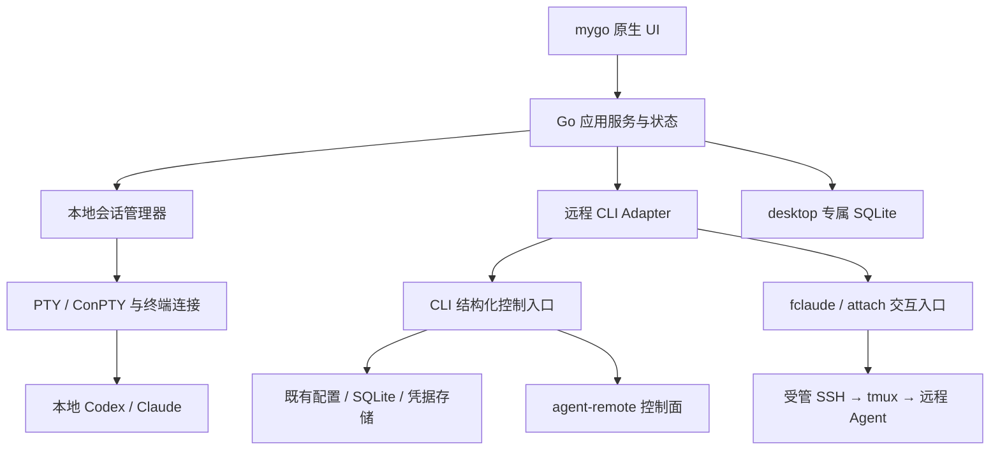

# agent-remote-desktop 产品与技术方案

状态：方案已定稿并按用户授权实施。当前代码与发布门禁以同级 `agent-remote-desktop/docs/implementation-status.md` 为唯一状态来源；本文件保留产品约束、架构边界和验收目标，不重复历史实现日志。

更新日期：2026-10-24。依赖版本、命令覆盖和验证结果以各仓库当前锁定文件与实施状态为准。

## 1. 已确认的产品约束

- 项目名为 `agent-remote-desktop`，使用 mygo，UI 与 desktop 自身业务代码全部使用 Go；允许原生动态库和现有 Rust CLI。
- 首发支持 Windows、macOS、Linux。FreeBSD 暂时不在计划中，也不列入后续里程碑。
- 正式 Release 统一按社区版交付：macOS 沿用项目持久社区自签身份；Windows/Linux 不要求发行者代码签名，Apple Developer ID 与公证不作为发布前提。无证书环境只能生成明确标记的 ad-hoc smoke 制品，不能冒充正式社区 Release。
- 以原生 Agent 终端为核心，支持本地 Codex、Claude，以及远程 fclaude；提供多会话、分屏、项目和状态管理。
- 首个正式版覆盖全部现有 CLI 命令，根据操作系统、用户权限、服务端及已安装组件能力显示入口。
- desktop 与 CLI 数据通用。
- desktop 全项目采用 i18n，统一使用 mygo 官方国际化机制；所有由 desktop 提供的用户可见文案均须可翻译。
- desktop 所有测试文件统一放在其自身 Git 仓库根目录的 `tests/` 下，与 `main.go`、`internal/`、`cmd/` 等主程序代码分离。
- 关闭窗口后应用在后台运行；明确退出应用时提示停止本地会话。
- 中度二次元风格：可切换主题、背景、角色立绘，终端区域优先保证可读性；操作简单，过渡流畅。

## 2. 产品定位与使用路径

定位：面向 agent-remote 用户的原生多 Agent 工作台，同时作为 CLI 的完整图形化入口。

两条主要路径共用项目与会话导航：

1. 本地工作：选择项目目录 → 选择 Codex / Claude → 新建终端会话 → 分屏或切换任务。
2. 远程工作：选择项目 → 选择远程账户 → 查看同步准备状态 → 启动或恢复 fclaude → 在同一工作台操作。

本地工作不依赖 agent-remote 登录或服务器在线。首次启动可直接打开本地项目，也可进入远程初始化向导。

首版把“多 Agent”定义为多个独立 Agent 会话的统一管理。自动拆任务、Agent 相互委派、统一聊天协议和完整 IDE 编辑器不纳入首版建议范围。项目所属 Agent、运行位置和账户始终可见。

首版管理 desktop 创建的本地进程；允许从工具支持的恢复入口开启历史会话，但不能承诺接管任意外部终端里已经运行的 Codex/Claude 进程。远程会话沿用服务端记录，可由 CLI 或 desktop 创建并在两端连接。

## 3. 当前界面结构

主窗口采用 Zen 工作区和按需展开的控制中心：

```text
┌──────────────────────────────────────────────────────────────┐
│                  1–4 个 Agent 终端面板                       │
│                                                              │
│                 本地 Codex / Claude / 远程 fclaude           │
│                                                              │
├──────────────────────────────────────────────────────────────┤
│ 项目 · Agent · 后台操作 · ⌥A ⌥C ⌥X ⌥S          呼吸条       │
└──────────────────────────────────────────────────────────────┘
```

- Agent 抽屉（⌥A）管理当前项目的会话卡片、事实状态和面板顺序。
- 新建圆环（⌥C）提供 Claude、Codex、fclaude 和高级审阅入口；项目圆环（⌥X）提供项目槽位、搜索和打开目录。
- 控制中心（⌥S、点击或上拉呼吸条）承载项目、远程、连接和系统页面。页面从右侧推入 Sheet，返回、上下文条和操作摘要统一处理。
- 组合键先由终端或当前输入控件处理，层快捷键不得向 Agent 泄漏字符；窗口关闭只隐藏应用，明确退出才处理本地会话。
- 终端、Agent 进程、远程会话、同步和操作回执是独立状态。没有结构化证据时只显示运行、连接、退出等可观测事实。

布局和动效的具体 token、手势与无障碍规则见 [desktop 重构方案](agent-remote-desktop-redesign.zh-CN.md)。

## 4. mygo 与 Go 技术路线

| 层次 | 推荐实现 | 作用 |
| --- | --- | --- |
| 应用与窗口 | mygo | 生命周期、菜单、托盘、窗口、通知和文件选择 |
| 原生界面 | `github.com/egoist/mygo/ui` | 布局、控件、虚拟列表、主题、输入法和动效 |
| 国际化 | mygo 官方 `i18n` 与生成式 Go catalog | 全应用文案、语言切换、复数及区域格式 |
| 终端 | `mygo/plugins/terminal` | 使用 libghostty-vt，承载原生 TUI 与终端交互 |
| 本地 Agent | Go 进程管理 + `charmbracelet/x/xpty` | 独立持有 PTY/ConPTY，启动 Codex/Claude，管理目录、参数、环境和进程生命周期 |
| 远程能力 | Go adapter → 现有 Rust CLI | 复用认证、设备、SSH、WireGuard、Mutagen 与业务操作 |
| 桌面本地状态 | SQLite（`modernc.org/sqlite`） | 仅保存窗口布局、主题、项目收藏和本地会话元数据 |
| 资源 | Go `embed` 与打包资源目录 | 图标、字体、内置主题和插画 |
| 更新与发行 | mygo 打包及更新能力 + 项目发布清单 | 锁定兼容 CLI / 原生库组合；macOS 社区自签，Windows/Linux 无发行者签名要求，三平台验证升级 |

选择原生路线，无需 Web 前端构建链。应用源码为 Go，不代表依赖中不存在其他语言：终端会加载平台对应的 libghostty-vt，远程能力调用 Rust CLI。

调研版本的 mygo `go.mod` 要求 Go 1.27.1。其终端文档列出 macOS 13+、Windows 10 1809+、Linux glibc 2.28+ 等底层条件；这些是依赖下限，不直接等于本产品的最终支持承诺。首轮验证后固定 OS 版本、CPU 架构与桌面环境矩阵。

desktop 已作为独立同级仓库维护，使用 GPL-3.0-only，并纳入根发布组合清单。

### 4.1 全项目国际化

采用锁定版本的 mygo 官方 i18n，不另建自定义翻译框架。当前提供英文 `en` 与简体中文 `zh-Hans`，英文作为源语言和缺失文案回退；语言范围可继续扩展。

- 在 `mygo.json` 配置 `"i18n": { "dir": "locales", "source": "en" }`，文案置于 `locales/<语言标签>.json`。使用官方 ARB 风格目录、ICU MessageFormat 和类型化占位符；业务键使用稳定的语义名称。
- 使用固定 mygo 版本的 `mygo generate` 生成 `locales/catalog_gen.go`，源目录和生成代码一起提交，保证普通 `go build` / `go test` 不依赖临时生成步骤。UI 与业务呈现层调用生成的 Go 函数，不硬编码自然语言、不拼接待翻译句子。
- 范围覆盖导航、表单、菜单、托盘、通知、对话框、状态、空态、校验、错误说明、恢复建议、无障碍标签及主题展示名称。机器错误码与状态 ID 保持稳定，在呈现层映射为本地化文案；CLI 管理界面同样遵守，不直接拿原始 CLI 帮助或错误文本替代完整本地化交互。
- 默认跟随系统语言，设置提供语言切换与“跟随系统”；使用 `mygo.App.SetLocale` 和框架持久化机制。自定义菜单、托盘和窗口标题通过 `OnLocaleChanged` 更新；切换语言不重启 Agent、不重建终端会话。系统原生对话框等遵循框架及平台实际生效时机。
- 日期、时间、数字与复数采用官方格式化能力，尊重系统区域设置；语言选择使用语言自称。未知语言回退到源语言，但正式版已支持语言不得靠回退掩盖漏译。
- Agent 原始终端输出、用户内容、代码、路径、命令参数和协议字段保持原样；这不豁免 desktop 自身围绕这些内容提供的说明、错误摘要与操作入口。

`mygo i18n check` 校验 catalog；上游对缺失翻译仅警告，因此项目另设已支持语言的完整性门禁。语言切换、中文/英文布局及 `en-XA` 伪本地化纳入测试，防止硬编码遗漏、长文本截断及占位符错误。

## 5. 运行架构



划分两个 Provider 即可起步：Local Provider 和 Agent Remote Provider。Provider 显式声明支持的工具、恢复、附件、远程停止等能力，不要求所有工具实现虚构的统一操作。

推荐模块：`app`、`ui`、`session`、`providers/local`、`providers/remote`、`cliadapter`、`operations`、`storage`、`platform`、`theme`。UI 不直接拼命令或读 CLI 数据库，平台差异集中在 platform 及终端适配处。

### 5.1 源码与测试目录规范

以下目录均相对独立的 `agent-remote-desktop` Git 仓库根目录，`tests/` 不是聚合仓库或主程序包内的目录：

```text
agent-remote-desktop/
├── main.go
├── internal/                 # Go UI 与业务实现，不放测试文件
├── cmd/                      # 产品及开发命令，不放测试专用程序
├── locales/                  # 官方 i18n catalog 与生成的 Go 代码
├── tests/
│   ├── app/                  # UI 与交互测试
│   ├── session/              # 会话管理测试
│   ├── terminalhost/         # PTY 与平台集成测试
│   ├── storage/              # 持久化测试
│   ├── workspace/            # 项目、标签与布局测试
│   ├── cliadapter/           # CLI 契约测试
│   ├── i18n/                # 翻译完整性与语言行为测试
│   ├── native-probe/        # 原生窗口专项测试程序
│   ├── testutil/            # 测试专用辅助代码
│   └── testdata/            # 测试夹具与视觉基准
├── scripts/                  # 构建及检查入口，可调用 tests/
└── docs/
```

所有自有 `_test.go`、单元/集成/UI/端到端测试、测试专用程序、辅助代码和夹具均放在 `tests/`；平台专用测试通过文件后缀与 build tags 区分，仍遵守同一位置规范。临时测试输出写入临时目录或忽略的制品目录，不混入主程序。

`tests/` 使用根 `go.mod`，不另建模块。同一模块下通过包导入测试 `internal/...` 的公开行为，不能假定测试迁移后仍可访问私有字段；优先通过依赖注入及可观察结果验证，不为测试暴露无业务意义的接口。检查入口和 CI 必须拒绝 `tests/` 以外出现自有测试文件，并同步原生测试程序的运行路径。

### 5.2 会话生命周期

终端视图与会话生命周期分离。会话管理器持有进程和连接，视图负责显示；关闭主窗口不能调用会终止进程的 `terminal.Close()`。后台期间持续读取输出，并以有界缓冲保留历史；重新打开窗口恢复原会话。此行为需要专项验证 mygo 在无可见窗口时的生命周期。

## 6. CLI 集成与数据通用

### 6.1 控制操作与交互终端分开

交互入口继续在 PTY 中运行 `fclaude`、`agent-remote attach` 或账户绑定需要的受管终端。保留原生 Agent 输入、颜色、快捷键、tmux 行为和参数透传。

已有远程 Claude 会话的图形化连接使用 `sessions.attach` v1 能力：冻结 CLI home、服务器、设备与完整会话 UUID，通过 `fclaude attach --expected-server/--expected-device` 连接。Rust 只提交一次授权，再只读观察原授权任务及数据库记录 UUID；Node 核对强制命令实际设备和 SSH key，不降级旧网关。历史存储 v3 保存公开连接上下文及有界的账户、节点、backend 展示元数据，兼容 v1/v2；展示元数据不作为授权或自动恢复依据，旧仅 ID 的历史必须刷新、重新选择及确认，存活连接按完整上下文和本地项目去重。CLI 同时声明 `attachment_transfer` v1 且限制合法时，desktop 才启用 Kitty 文件/图片 payload；否则保持 text-only。真实 Server/Node/SSH 传输和清理回执仍需发布前联调。见[连接合同](../../agent-remote-desktop/docs/remote-session-attach.md)与[后续会话管理计划](../../agent-remote-desktop/docs/remote-session-management-plan.md)；创建、停止、删除及转发仍需独立完成。

控制操作使用已实现的版本化结构化协议。`agent-remote --desktop-control` 通过 stdin/stdout JSONL 交换请求、有界进度事件和最终回执；每次操作可启动一个 CLI 子进程，不需要常驻远程业务 daemon。

当前实现使用独立 `agent-remote --desktop-control` 入口，覆盖能力发现、共用配置上下文、账户与会话查询、密码/MFA 与浏览器设备码登录、可选设备登记、注销、环境与依赖诊断及各专用变更流程，见 [CLI 协议](../../agent-remote-cli/docs/desktop-control.md)。设备码授权使用专用审批事件；未完成的服务端和目标主机证据以实施状态为准。

本地初始化/元数据修复另有显式确认的 `setup.local`：创建缺失目录、数据库表及依赖清单，返回分步完整/部分结果；不读取凭据、不访问网络或安装依赖。与普通 CLI 复用本地准备服务，保留已有有效内容，拒绝损坏/未来版本数据库及无效清单。该入口是完整初始化的基础部分，不等于登录、WireGuard、依赖安装和持久恢复已全部完成。

WireGuard 配置已接入 `wireguard.config.plan/apply`：只读预览绑定准确服务器、设备、输出路径及文件身份，用户确认完整计划后才登记公钥和发布配置。普通 CLI、`init` 的可选步骤与 desktop 共用 Rust 服务，desktop 不读取私钥或配置正文。结果分别保留密钥保存、远端登记及本地发布阶段；中断或丢失回执显示未知，不自动重试。网络页也已接入 `wireguard.tunnel.plan/apply`，通过固定平台 broker client 执行 up/down 并复查目标状态；没有受保护 broker 时保持 fail-closed。真实 broker 安装、授权、up/down 和恢复仍需目标主机验收，操作中心只跨重启保留安全生命周期摘要，精确回执由 CLI journal 管理。实际验证见 [WireGuard 配置契约](../../agent-remote-desktop/docs/wireguard-configuration-plan.md)和实施状态。

网络页已接入 `wireguard.check/status`：进入页面不自动执行，用户显式检查默认/自选配置或读取状态，无需登录。Rust 有界检查私有配置，只返回非敏感摘要；状态解析一次 `wg show all dump` 并剔除私钥/PSK，区分没有接口与查询失败，不自动提权。Go 严格校验结构与完整整数，UI 使用官方数字/时间本地化，支持分别取消与接口/peer 分页。配置发布取消在途查询、使旧结果失效；查询不重试。普通 CLI/helper 的 check 共用校验服务，普通人类 status 保留既有行为。只读隧道计划见下段，平台 broker client 已接入但真实受保护 service、授权和运行验收仍需实现，详见[检查与状态契约](../../agent-remote-desktop/docs/wireguard-inspection-contract.md)。

网络页进一步接入 `wireguard.tunnel.plan/apply`：选择启动/停止方向与配置后，展示同一安全配置快照、工具身份/摘要，以及 Linux namespace/接口、macOS 映射/utun/socket 或 Windows SCM 服务的原生观察。计划重查通过且 issues 为空时才可确认执行；Rust 在用户权限下读取配置并通过固定平台 broker client 发送字节/摘要，broker receipt 后再次观察并返回 observed/失败/未知回执。没有 sudo、runas 或普通 helper fallback。观察失败与不存在明确区分，原生前后快照变化使结果失效；down 条件核对配置公钥及 Windows 配置对象身份。三平台真实 broker service 安装、授权、隧道存活仍需验收，不能把替身测试计为正式版 up/down 覆盖。界面和测试继续遵循官方 i18n 与仓库根 tests/ 规则，详细字段及边界见[隧道只读计划契约](../../agent-remote-desktop/docs/wireguard-tunnel-contract.md)。

协议至少包括：版本协商、能力列表、请求 ID、操作 ID、结构化错误、当前阶段、需要的用户输入、确认内容、最终结果与原始服务端回执。长时间操作产生事件；无法获知百分比时显示阶段和不确定进度，不伪造百分比。

GUI 填表替代 shell 提示，确认绑定到准确请求。密码与 token 通过受控输入通道传递，不出现在命令参数和日志。取消本地等待与取消远程任务必须分别表达；网络断开后先查询原操作结果，不能直接重放 mutation。

运行中的操作不阻止用户返回工作台。侧栏及命令搜索提供状态入口，跨页导航保留进度、取消入口及最终回执，结果由用户明确确认后清理。改变登录上下文后失效旧远程列表和未提交计划，拒绝迟到查询回填。操作中心跨重启保存不含敏感信息的生命周期摘要；精确 request key、回执和执行上下文继续由 CLI journal 管理，desktop 不会自动重放原操作。

GUI 不解析面向人的 ANSI 表格，不靠自动输入 `yes` 驱动流程，不把“打开终端让用户敲命令”计为管理操作的图形化完成。工具自身的交互式登录仍允许在嵌入终端中进行。

WireGuard 的 P2 执行基础已增加 Rust 私有快照、系统保护目录、认证权限桥、平台 broker client 和不可重放的请求记录，桌面网络页可审阅并提交冻结计划。详情见[执行基础契约](../../agent-remote-cli/docs/desktop-wireguard-execution.md)。未安装真实受保护 service 时执行保持 fail-closed；三平台实际安装、授权、启停、重放拒绝与恢复验收仍是正式版要求。

### 6.2 共用数据的所有权

默认账户图形化已通过 `accounts.default.get/set/clear` 与普通 CLI 共用 Rust 服务。确认绑定当前配置环境及旧默认值，发布前复验上下文并以 SQLite 事务防止覆盖并发修改。查询不初始化数据库；清除无需联网或凭据；设置验证完整账户 ID 和工具类型。沿用现有 home/工具作用域，不新增按服务器分区，界面需明确默认值跨服务器共用。操作中心跨重启恢复安全生命周期摘要，精确回执仍由 CLI journal 查询，实际验证见[实施状态](../../agent-remote-desktop/docs/implementation-status.md)与[默认账户契约](../../agent-remote-cli/docs/desktop-account-defaults.md)。

项目同步页已接入 `sync.status/ensure/pause/resume/resolve/reset`，与普通 CLI 共用 Rust 操作服务和原 SQLite 映射。确认绑定 home、服务器、设备、规范项目路径、工作区及同步 ID，并以目标指纹覆盖节点、远端路径、SSH 端点、Mutagen 名称和同步规则。状态查询使用 Mutagen 官方结构化模型，不初始化同步数据库、不启动或重启守护进程；Server 准备状态、本地暂停/运行状态和冲突观察分别显示。`--dry-run` 保留既有 CLI 语义：仅跳过本地 Mutagen 执行，Server 与 SQLite 仍可能变化，界面须明确说明。

同步操作保留 Server、Mutagen 和本地持久化的独立阶段，取消、超时或回执丢失不表示回滚，也不自动重放。恢复和重建需核对原目标；解决冲突是用户先修改文件后重新检查，不自动选择文件版本。仅在本地完成同步周期、两端状态可确认且没有报告冲突/错误时才清除服务端冲突标记。重建会重新建立同步基线，可能重新出现旧删除或冲突。新版条件操作还需协商 Server 的目标条件检查能力，旧服务端不能静默降低并发保护。具体协议见[同步契约](../../agent-remote-cli/docs/desktop-sync.md)，当前验证及剩余工作见[实施状态](../../agent-remote-desktop/docs/implementation-status.md)；六个图形入口不等于 P2 整体完成。

旧映射恢复使用独立的 `sync.recovery.preview/apply`：只读核对服务端明确返回的不存在状态、本地完整映射及 Mutagen 精确会话，用户审阅后确认清理。终止仅针对复验一致的原会话 ID，保留两端文件和无关会话；SQLite 通过完整快照比较后删除，工作区仍存在时保留其映射。工具缺失、守护进程未运行、元数据不完整、权限或网络错误不能推断为会话不存在。清理完成后重新查询并另行确认建立关系，原操作与恢复回执均保留；操作中心持久化的内容只是不含敏感信息的生命周期摘要，精确回执继续由 CLI journal 管理。全局 Mutagen SSH 环境恢复采用独立的 `mutagen.environment.preview/apply` 与“同步运行环境”页面，无需项目、登录或数据库。预览包含同一数据目录内全部同步和转发会话、暂停状态、完整配置摘要，以及上次记录与当前选择的 home/工具环境；停止的守护进程也从持久元数据读取清单。确认绑定整个计划摘要，执行前复验环境、工具、会话配置及运行代次；普通项目操作不能隐式重启已有环境。重启后核对配置和暂停状态，再发布绑定 namespace、home 身份和 daemon 代次的 v2 标记。部分完成或未知结果保留原确认范围，不自动重放原项目操作。普通 CLI 使用相同实现，入口为 `deps mutagen-environment [--repair]`。当前已验证 macOS 官方 Mutagen 与真实 Go→Rust 调用链；外部 launchd 注册显示为受阻，服务接管和三平台原生验收仍待完成。协议与边界见[全局环境恢复契约](../../agent-remote-cli/docs/desktop-mutagen-environment.md)。

权限桥的三平台实施提案见[权限桥设计](../../agent-remote-desktop/docs/wireguard-bridge-design.md)：Rust 已接入 macOS Unix-socket、Linux system D-Bus、Windows named-pipe broker client，以及 caller identity、配置摘要和一次性 permit 合同；仓库同时提供 macOS LaunchDaemon、Linux systemd/D-Bus/Polkit service、Windows 受保护 worker/SCM 的安装材料和 host-only acceptance。未安装真实受保护 service 时执行保持 fail-closed，目标主机上的安装、调用者授权、隧道存活和重启恢复仍需逐平台完成。正式 Release 采用社区版，macOS 沿用项目社区自签，Windows/Linux 不要求发行者代码签名。提交记录持久化与可信工具安装需在正式发布前复核。

| 数据 | 权威来源与访问方式 |
| --- | --- |
| 服务器地址、当前设备、默认账户 | CLI 原有配置与状态，通过 CLI 控制入口读写 |
| 登录及续期凭据、SSH/WireGuard 密钥 | CLI 原有凭据机制；desktop 不另存一份 |
| 工作区、同步与远程会话 | 既有 CLI / 控制面模型；沿用服务器 ID 和项目标识算法 |
| Skills 及操作恢复日志 | 复用 CLI 已有作用域、幂等键、原始回执与恢复规则 |
| 本地 Agent 登录态和历史 | 由 Codex/Claude 自己管理；desktop 不全量复制其用户目录 |
| 主题、分屏、收藏与本地会话元数据 | desktop 专属数据库，不修改 CLI schema |

沿用 `--home` / `AGENT_REMOTE_HOME` 语义和现有平台路径；desktop 专属数据建议位于所选 home 的 `desktop/` 子目录。必须显示实际关联的配置环境，避免系统 CLI 与内置 CLI 指向不同目录。

desktop 管理调用和用户 shell 调用都通过 CLI 的存储逻辑写数据。CLI 控制契约工作同时验证跨进程刷新锁、配置原子写、SQLite 写竞争和设备登记幂等性，不能只依赖 GUI 自身的操作队列解决双端并发。GUI 在回到前台或操作完成时刷新，后续再按需要加入变化通知。

desktop 将 Rust `agent-remote`、`fclaude` 以及 Codex/Claude 作为外部运行时依赖，按 PATH 或用户显式配置探测并记录版本、来源和摘要；发布制品只携带 desktop 与终端原生库，不静默复制、签名或安装这些 CLI。启动时校验机器协议及共享数据版本，允许系统 CLI 共存。升级使用明确兼容矩阵；不兼容时停止升级或给出清晰提示，不能静默覆盖共享状态。

当前账户页已接入创建、状态、绑定、验证与停用的确认流程。绑定登录使用单独终端能力和准确账户/绑定批次，保存的历史先刷新再确认；Server/Node 需要配套支持准确批次与当前 SSH key 校验，并通过实际网关能力探测启用。受理回执不代表工具登录完成，停用不删除凭据或停止已有会话。

账户配置导入按本地发现、完整文件清单审阅、可选 Server 策略校验、独立上传确认及原请求恢复分开实现。默认不包含历史记录；排除 Skills 仅排除账户 `.claude/skills`，不改变插件或项目作用域。Server 策略校验沿用 CLI `--dry-run`，会写审计，不能称为纯只读。Go 只接收路径、大小、摘要和阶段；文件正文由 Rust 有界读取并在提交前重新核对，拒绝链接、文件替换和超限。

导入提交使用 CLI 唯一持久记录，在第一次 POST 前保存原请求 UUID、上下文及意图摘要；Server 将原请求与任务原子关联。响应丢失后只查询原请求及其准确任务，不猜测 latest，不自动重传或生成新键。状态查询不更新本地导入记录或 Server 设备活动时间；清理终态记录需要重新核对任务，未决请求不能清理。该流程的实现及验证范围见[导入协议](../../agent-remote-cli/docs/desktop-account-import.md)和[实施状态](../../agent-remote-desktop/docs/implementation-status.md)，不代表三平台原生验收已完成。其他业务的精确回执恢复仍由各自 CLI journal 契约负责，desktop 操作中心仅保存安全生命周期摘要。

管理员运行时恢复采用独立维护入口与 `accounts.runtime_recovery.authority/inspect/apply/status/pending/forget`，只接受用户身份，设备凭据不能获得管理员权限。先显式检查管理员身份，再观察准确原迁移任务，单独选择验证目标、验证源或修复源并确认；观察状态不等于可执行资格。确认绑定管理员、服务器、账户所有者、节点、原任务记录与源/目标后端，Server 在既有写锁内复验完整原任务投影。账户所有者与操作管理员可以不同，不创建第二套恢复任务或 Node 执行协议。

CLI 保存唯一的公开请求键与不可变回执元数据；首次提交前保留原键，丢失响应后只查询准确原键，不自动重放或换键。手动查询历史请求仅观察，不生成提交计划或本地记录；明确拒绝可确认后离线清理，其他记录须重新查询并证明准确任务已终态才可清理。机器查询不刷新、迁移或初始化用户凭据。该切片已通过本机跨语言及整仓检查，三平台原生验收仍待完成；具体契约见[运行时恢复协议](../../agent-remote-cli/docs/desktop-runtime-recovery.md)，最终验证范围以[实施状态](../../agent-remote-desktop/docs/implementation-status.md)为准。

## 7. 全部现有 CLI 能力的图形化映射

以下是当前源码命令族映射。正式版验收以从发布基线生成的逐子命令、逐参数清单为准，包含低频参数、高级入口、dry-run、完整 ID、作用域、分页及恢复操作。

| CLI 命令族 | GUI 位置与交互 |
| --- | --- |
| `init / login / logout / status` | 首次设置向导、登录页、当前连接与设备状态、注销范围选择 |
| `doctor / deps status`，含 fix | 诊断页：逐项检查、建议修复、修复过程与结果 |
| `wireguard config/check/status/up/down` | 网络页：配置、检查、连接、断开；系统权限交给平台授权入口 |
| `ssh check / attach` | 连接诊断、会话连接、连接命令预览与复制 |
| `sync ensure/status/pause/resume/resolve/reset` | 项目同步页：建立关系、状态、冲突处理、暂停、恢复、重建 |
| `account create/list/bind/attach/import-config/verify/status/disable/default` | 账户页：账户列表、绑定向导、配置导入、验证、默认账户 |
| `account recover-runtime/recovery-status` | 账户高级维护页，按管理员权限展示，查询原恢复操作 |
| `credentials list/create/bind/unbind` | 开发凭据页：Git 身份、gh/SSH 模式和账户绑定 |
| `forward` 及 `list/stop` | 会话端口页：创建、自动分配本地端口、打开页面、TTL、列表与停止 |
| `fclaude run/new/list/attach/stop/stop-status/delete/forward` | 会话列表与菜单：创建、恢复、筛选、停止并查看保存进度、删除和端口管理 |
| `skill add/check/update/enable/disable/pin/unpin/inherit/remove/rollback/list/info/status/retry` | Skills 库：来源、版本、作用域规则、实际解析结果、操作记录与重试 |
| `skill state list/conflicts/info/diff/export/prune/reset/migrate/resolve/restore` | Skills 状态页：历史、差异、导出、冲突、迁移、恢复和清理向导 |
| `device install/uninstall/status/launch/diagnose/revoke/rotate-token` | 设备页：安装、运行、诊断、卸载与凭据生命周期；目前主要为 macOS 能力 |
| `ego-browser setup/connect/repair/upgrade/remove/forget-this-mac` | 浏览器连接向导与本机安装维护 |
| `ego-browser re-enroll/device-rotate/switch-server/register/status/list` | 浏览器身份与状态页，兼容入口放在高级设置 |
| `ego-browser requests/cancel-request/claim/pause/resume/stop/revoke/delete-device/delete-binding` | 绑定详情、执行请求列表、生命周期与清理；区分暂停、停止和撤销 |
| `node install` | 有权限用户的节点安装向导：选择节点、验证制品、安装及加入状态 |

每项命令建立三类映射：输入表单、进度/结果呈现、错误/恢复交互。CLI 的自动化输出参数不必照搬成开关，但对应的查看、导出、完整 ID 和预览能力必须有清晰入口。

远端账户 backend 由现有策略决定，desktop 不提供绕过策略的切换。同步冲突不能被“继续”按钮静默覆盖。设备与浏览器的显式授权、暂停/恢复语义保留现有契约。

入口可用性同时检查 OS、用户权限、CLI 版本、组件安装和服务器能力。不存在的平台能力从常用导航隐藏，在能力说明页说明原因；用户有权限但尚未安装的能力提供安装或修复入口。服务端仍执行实际权限检查。

当前实现的“能力说明”页通过只读协议区分 CLI 支持、配置前提和已观察到的权限结果，命令清单支持筛选及逐命令平台声明。每个已发现的叶子命令都可打开 schema 驱动的通用表单，生成 defaults、required/min/max、choices、SetTrue/SetFalse/Count、Append 和 positional 参数；Review 阶段冻结 argv 后在受管终端启动。旧 CLI 缺少平台字段时显示“未声明”，不推断全平台可用；平台声明不继承父命令。已知能力会结合相同配置目录、服务器和设备的已完成查询显示可用、需设置、需设备、需登录或拒绝等状态，未建立映射的命令保留 unknown 并允许用户明确尝试，CLI 负责最终授权。新建及恢复 Agent 会话在工具缺失时禁用启动，提供安装指引、手动刷新，并在启动前重新检测。通用表单不替代专用业务确认、阶段回执、恢复语义或三平台原生验收，进度见 [实施状态](../../agent-remote-desktop/docs/implementation-status.md)。

## 8. 会话与后台行为

| 操作 | 本地 Codex / Claude | 远程 fclaude |
| --- | --- | --- |
| 切换标签 / 隐藏面板 | 保留进程与输出读取 | 保留连接或按明确策略断开视图 |
| 关闭主窗口 | 应用转后台，Agent 继续 | 应用转后台，远端 Agent 继续 |
| 重新打开窗口 | 恢复现存终端实例与布局 | 恢复连接状态和视图 |
| 关闭一个活跃会话标签 | 区分隐藏标签与停止进程，提供明确选择 | 默认断开视图，停止远程任务为独立操作 |
| 明确退出应用 | 列出活跃本地会话，确认后优雅停止，超时再询问强制终止 | 断开连接，远端会话继续运行 |
| 应用崩溃 / 系统重启 | 不承诺进程存活；重启后提供工具支持的历史恢复入口 | 查询服务器并重连仍存活的会话 |

首版采用同一 desktop 进程负责后台管理，关闭窗口不退出；不引入“完全退出后本地任务仍存活”的独立服务需求。首次关闭窗口给出简短后台说明，托盘/菜单提供“打开工作台”和“退出”。Linux 无可用托盘时须提供可靠的重新打开方式，例如单实例启动唤回。

区分终端连接状态、Agent 进程状态、远程会话状态、同步状态；断线不显示为任务完成。复用原有 tmux 单终端接管语义，不对同一远程会话重复创建多个写入连接；CLI 与 desktop 互相接管时清晰提示。

所有跨会话控制都选择准确目标；首版不默认广播输入。用户想让多个 Agent 修改同一项目时提示共享工作目录事实，后续可增强 worktree 流程，但不自动承诺隔离。

## 9. 视觉系统与动画

推荐方向：二次元工作室。外围具有插画和角色表达，中央保持高密度、稳定的工具界面。

- 默认深色主题采用深蓝灰底、低饱和冰蓝主色和少量樱粉点缀；同时提供浅色主题。
- 背景画主要出现在欢迎页、空状态、侧栏或窗口边缘；终端默认使用接近不透明的背景，支持用户调整。
- 角色立绘位于可收起的侧区或空闲页；分屏、窄窗口、聚焦模式下自动收起，不能覆盖光标、输出或表单。
- 首版推荐两套完整主题，允许切换背景、角色与强调色；“专注模式”一键收起装饰并保留布局。
- 主题切换不影响 ANSI 语义色和状态可读性。普通文字对比度目标至少 4.5:1；状态同时使用文字与图标表达。
- 界面正文建议 13–15 DIP；终端建议 14 DIP 起，用户可独立调字号与行高；优先测试中文、英文、emoji 与字体回退。
- 使用原创或许可清晰的角色素材。首版建议静态立绘与轻微转场；Live2D、持续粒子和角色对话作为单独扩展，不混入基础实现。

| 动效 | 建议时长与行为 |
| --- | --- |
| Hover / 按下反馈 | 80–120 ms，局部颜色或透明度变化 |
| 侧栏与详情栏展开 | 160–220 ms，跟随布局的小幅位移 |
| 标签与页面切换 | 120–180 ms，淡入与短距离位移，焦点立即可用 |
| 对话框 | 160–220 ms，轻微缩放与透明度 |
| 主题切换 | 200–300 ms，表面和背景过渡，终端内容不重建 |

使用 mygo 原生 motion / transition 能力。所有动效可中断并响应系统减少动态效果设置；拖动分屏不加延迟动画，持续终端输出不逐行入场。后台和静止状态停止装饰动画。

## 10. 发布、性能与验证

首个正式 Release 固定交付三个 artifact triple：`windows/amd64`、`darwin/arm64`、`linux/amd64`；Windows ARM64、macOS Intel 和 Linux ARM64 可以通过构建脚本做兼容性 smoke，但在另行取得真实主机运行证据前不列为正式支持。Linux 正式验收至少覆盖固定的 Ubuntu/Debian 发行版组合及 X11、Wayland 图形会话；其他发行版标记为 best-effort。FreeBSD 无交付项。

本地 Codex/Claude 是否可用取决于对应工具在该 OS/架构上的实际支持，desktop 探测可执行文件并显示状态。原生 Windows 工具与 WSL 是不同环境，不自动混用路径、凭据和进程；WSL 不作为本轮默认支持承诺。

打包包含 desktop 与验证过的终端原生库；系统依赖如 Linux GTK 按平台包声明。`agent-remote`、`fclaude`、Codex 和 Claude 保持外部运行时依赖，由各自发行方式安装和更新，desktop 只负责检测、兼容性校验和引导，不把 CLI 静默复制进制品。应用更新与 CLI 数据兼容、组件校验和回滚策略一起验收。

正式 Release 按社区版交付：macOS 使用项目社区自签身份，无需 Apple Developer ID 或公证；Windows/Linux 不要求发行者代码签名。公开构建流程与制品校验用于验证来源和完整性，不能代替安装目录保护、系统授权与权限组件调用者身份核验。macOS 固定社区证书指纹与受信任安装流程，签名私钥不进入仓库或 Release 制品。三平台安装、更新及安全校验均按这一发行策略实施，不以商业证书作为发布前提。

性能先定测量方法再定正式预算。推荐原型目标：已加载会话切换和输入反馈 p95 小于 50 ms；参考设备前台动效接近 60 fps；10 个存活会话、4 个可见终端下无明显输入卡顿。测量明确硬件、输出速率和历史上限；不把模型响应时间计入 UI 延迟。

终端历史使用可配置的每会话与总量上限；不可见面板停止绘制但继续接收输出，批量合并刷新；列表虚拟化，角色图片按显示尺寸解码缓存。

正式版验收包括：

1. 每个现有 CLI 子命令及有意义的参数组合有 GUI 对应，覆盖表无遗漏；不适用项有明确平台或权限依据。
2. CLI 登录后 desktop 直接识别；desktop 修改默认账户、同步等后 CLI 可见；双端并发登录续期和状态写入不损坏数据。
3. 三平台实际运行 Codex/Claude 或适用的支持组合，测试中文 IME、emoji、全屏 TUI、复制粘贴、图片/文件附件、拖放、缩放、分屏和窗口 resize。
4. 远程新建、恢复、CLI/desktop 接管、网络中断、同步冲突、停止保存与失败恢复符合既有语义。尤其验证 mygo 剪贴板处理与 CLI OSC/附件桥接不会重复消费。
5. 关闭所有窗口后进程继续；唤回恢复；显式退出显示准确的本地会话；没有托盘的 Linux 桌面可恢复窗口。
6. 权限不足、旧服务端、缺失组件、CLI 协议不兼容、操作中升级均有可理解的处理。
7. 主题切换、减少动态效果、键盘导航、高 DPI、浅深色与长列表可读性通过检查。
8. 全应用用户可见文案走官方 i18n；已支持语言翻译完整，生成文件与 catalog 同步；切换语言、系统语言回退、区域格式与长文本布局通过验证，终端会话保持运行。
9. desktop 所有测试及测试专用资源位于仓库根 `tests/`，主程序目录不含测试文件；目录门禁、i18n 门禁和适用平台测试均通过。

## 11. 当前交付状态与门禁

| 阶段 | 当前状态 | 发布前剩余门禁 |
| --- | --- | --- |
| P0 可行性与契约 | 已完成：mygo 原生窗口/PTY、i18n、测试目录和 CLI schema/control 契约已建立 | 目标主机的运行证据仍需按平台矩阵补齐 |
| P1 工作台 | 已完成：Zen 工作区、本地会话、分屏、恢复、主题、语言和后台生命周期 | Windows/Linux 真实 Agent TUI、IME、附件和托盘验收 |
| P2 远程基本闭环 | 结构化流程和受管终端入口已实现 | 真实 Server/Node/SSH/fclaude、Mutagen restart recovery、WireGuard broker |
| P3 全量 CLI 覆盖 | 当前 schema 清单的叶子命令均有专用页面、受管终端或通用表单入口 | 服务端授权、阶段回执、恢复和三平台原生证据 |
| P4 视觉与发行 | R0–R6 UI 重构、社区版构建和离线制品验证已完成 | Windows amd64、Linux amd64 X11/Wayland、安装器、性能和远程发布证据 |

正式发布必须固定所有组件 commit、制品、schema 和兼容性证据，并由用户审阅后决定是否发布。交叉编译、合同夹具和 host-only 预检不能替代原生或真实远程证据。

## 12. 调研依据

- [mygo README（固定调研版本）](https://github.com/egoist/mygo/blob/269e2f9aca82b742f67497e467a95f6adb54bf5d/README.md)
- [mygo 平台说明](https://github.com/egoist/mygo/blob/269e2f9aca82b742f67497e467a95f6adb54bf5d/docs/README.md)
- [mygo 原生终端插件](https://github.com/egoist/mygo/blob/269e2f9aca82b742f67497e467a95f6adb54bf5d/docs/plugins/terminal.md)
- [mygo 动效](https://github.com/egoist/mygo/blob/269e2f9aca82b742f67497e467a95f6adb54bf5d/docs/ui/motion.md)
- [mygo 官方 i18n（固定调研版本）](https://github.com/egoist/mygo/blob/269e2f9aca82b742f67497e467a95f6adb54bf5d/docs/i18n.md)
- 同级 CLI 仓库：`src/cli.rs`、`src/cli/skills.rs`、`src/cli/skills/state.rs`、`src/bin/fclaude.rs`、`src/config.rs`、`src/local_state.rs`、`src/platform.rs`、`docs/rules/09-local-state-secrets.md` 与 `README.zh-CN.md`。
- 根仓库现有运行架构及设备/浏览器契约：`README.zh-CN.md`、`docs/agent-remote-architecture.md`、`docs/ego-browser-humanized-lifecycle.md`。
